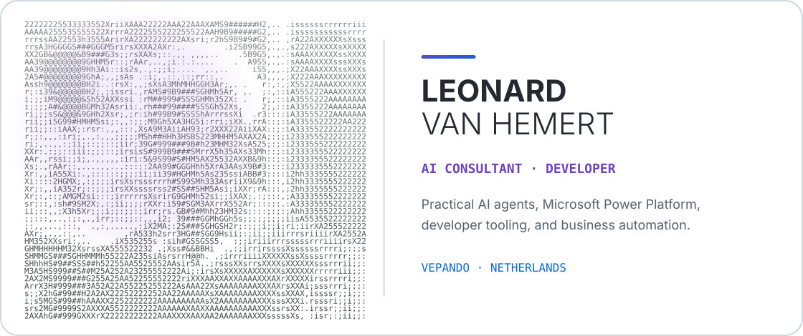

<picture>
  <source media="(prefers-color-scheme: dark)" srcset="./assets/ascii-hero-dark.svg">
  <source media="(prefers-color-scheme: light)" srcset="./assets/ascii-hero-light.svg">
  
</picture>

# Leonard van Hemert

AI Engineer and founder of [VEPANDO](https://vepando.com).

I build software, AI agents, and developer tools. My interests lie in agentic systems, AI-assisted software engineering, developer infrastructure, and applied AI.

I work across the stack, from application architecture and API integrations to deployment, automation, and self-hosted infrastructure.

## Engineering interests

- Agentic systems, tool calling, and MCP
- AI-assisted software engineering
- Developer tooling and agent skills
- LLM integration and inference
- Application architecture and performance
- Self-hosted infrastructure and automation
- Reproducible computational research

## Stack

**Languages:** TypeScript, Python, Swift  
**Application development:** React, Next.js, Node.js  
**AI engineering:** Claude Code, Codex, MCP, LLM APIs  
**Infrastructure:** Docker, Linux, GitHub Actions, n8n  

## Selected projects

| Project | Description |
| :--- | :--- |
| [liquid-glass-react](https://github.com/LeonardSEO/liquid-glass-react) | SVG-based optical refraction for React. No WebGL or canvas. |
| [ForgeReels](https://github.com/LeonardSEO/ForgeReels) | Local video production pipeline with AI-driven scripting, speech synthesis, rendering, and quality control. |
| [performance-engineering](https://github.com/LeonardSEO/performance-engineering) | Framework-independent performance engineering skills and hooks for coding agents. |
| [ux-clarity](https://github.com/LeonardSEO/ux-clarity) | Agent skill for information architecture, navigation, and interface usability. |
| [pstack-for-codex](https://github.com/LeonardSEO/pstack-for-codex) | Engineering workflows for architecture, debugging, code review, and verification in Codex. |

## Current work

Building AI-native applications and improving the reliability of agent-assisted software development.

Interested in how autonomous agents interact with codebases, external tools, and production environments, particularly around context management, execution reliability, and verification.

## Elsewhere

[Website](https://vepando.com) · [Portfolio](https://leonardseo.github.io/) · [LinkedIn](https://www.linkedin.com/in/leonard-van-hemert/)
